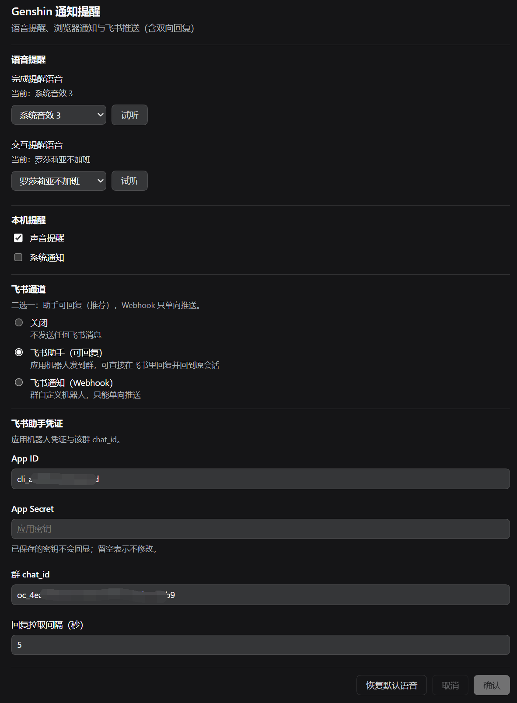
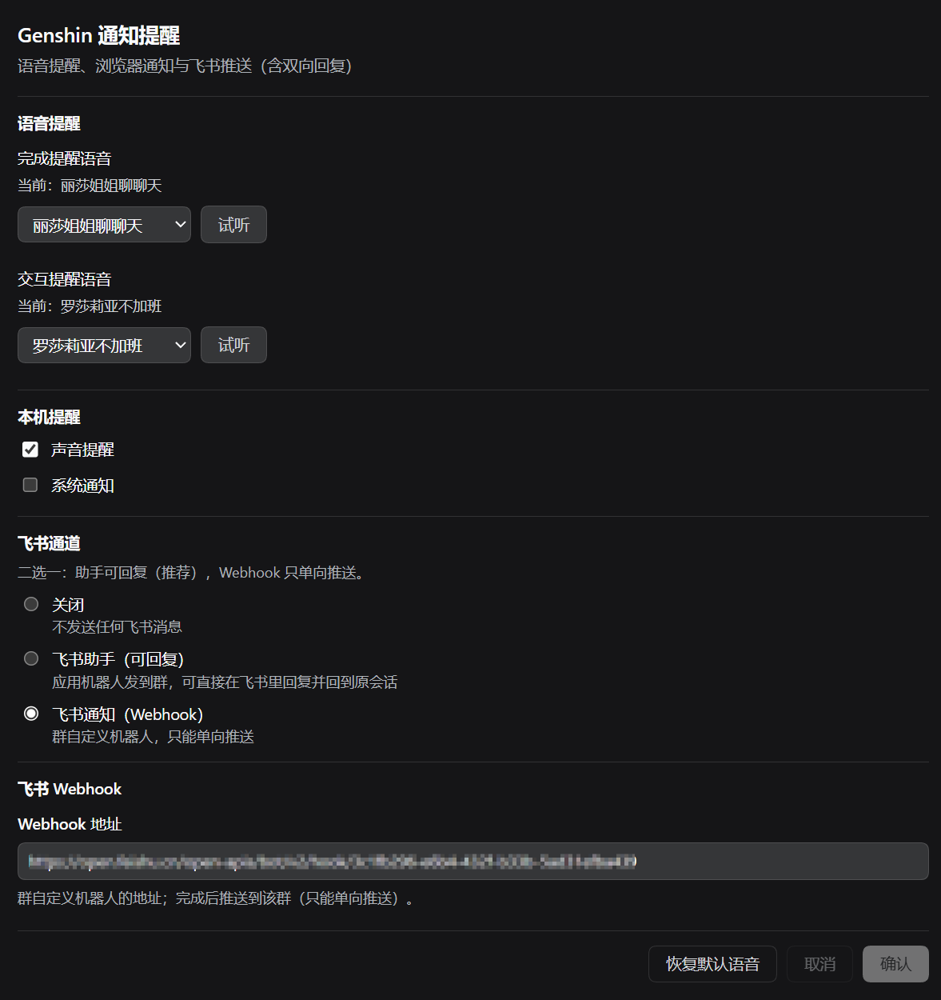

# dsh-genshin-lisa-notice

把 DSH 的「任务完成 / 需要你的输入 / 任务失败」变成**听得见、看得到、还能在飞书里直接回复**的通知。

- 🔊 语音提醒 —— 包内 8 个语音，也可以上传自己的 mp3
- 🖥 浏览器系统通知 —— 带任务摘要，一次通知一个会话
- 💬 飞书双向通道 —— 通知发到群，**在飞书里引用回复就能把内容送回原会话**（提问卡片则直接当作答案）

> 名字来源：DLC「萦萦拜托」的报时妖精丽莎，任务做完就会来提醒你一下。

---

## 它能在什么时候提醒你 / What it alerts on

| 情境 | 触发时机 | 本机提醒 | 飞书 |
|---|---|---|---|
| ✅ 任务完成 | 回合即将关闭 | 语音 + 系统通知（含任务摘要） | 绿色卡片 |
| 💬 需要你的输入 | agent 调用 `ask_user_question` | 语音 + 系统通知（含问题） | 橙色卡片，**回复即作答** |
| ⚠️ 任务失败 | 请求报错（欠费 / 鉴权 / 限流 429 / 5xx / 网络异常 / 超时） | 语音 + 系统通知 | 红色卡片，带 HTTP 状态码与错误码 |

## 截图 / Screenshots

**飞书助手（可回复）模式** —— 选定助手后才会展开凭证字段：



**飞书通知（Webhook）模式** —— 同一个面板切到 Webhook，助手凭证换成 Webhook 地址：



---

## 安装 / Install

```powershell
# 方式 A：从 GitHub 装（最新功能）
dsh plugin add github:EagleClark/dsh-genshin-lisa-notice

# 方式 B：从 npm 装
dsh plugin add dsh-genshin-lisa-notice
```

> ⚠️ **npm 上的版本可能落后于仓库**（发布需要维护者手动执行）。要双向飞书助手，请用方式 A，或确认 npm 上的版本 ≥ 0.17.0。

装好后重启 DSH Desktop。

## 配置入口 / Where to configure

同一张表单，三个入口，内容完全一致：

| 入口 | 位置 |
|---|---|
| **左栏工作台图标** | 左侧图标栏「通知提醒」，点开就是主面板 |
| **设置页** | 设置 → 「Genshin 通知提醒」（与「通用设置」同级） |
| **插件详情页** | 插件 → dsh-genshin-lisa-notice → 配置 |

## 表单怎么用 / The form

- 表单分区：**语音提醒 / 本机提醒 / 飞书通道 / （助手凭证 · Webhook 地址）**
- **飞书通道是三选一**：`关闭` / `飞书助手（可回复）` / `飞书通知（Webhook）`
  - 选中哪个，就**只显示哪个通道的字段**；另外两个状态的字段不渲染，也不亮着
- **不点「确认」不会生效**：所有改动都只改本地暂存，`确认` 才逐字段写入；`取消` 丢弃全部未保存修改
- `恢复默认语音` 只把两条提醒语音恢复成包内默认
- `App Secret` **不回显**，留空表示"不修改"

### 字段说明

| 字段 | 说明 |
|---|---|
| 完成提醒语音 | 任务完成时播放；默认「丽莎姐姐聊聊天」 |
| 交互提醒语音 | 需要你输入 / 任务失败时播放；默认「罗莎莉亚不加班」 |
| 声音提醒 | 是否播放语音（默认开） |
| 系统通知 | 是否发浏览器通知（默认开，需要授权） |
| App ID / App Secret | 飞书自建应用的凭证（`cli_` 开头） |
| 群 chat_id | 机器人所在群的 id（`oc_` 开头） |
| 回复拉取间隔 | 轮询群里回复的间隔，2–60 秒，默认 5 |
| Webhook 地址 | 群自定义机器人的 Webhook，只能单向推送 |

---

## 飞书通道 / Feishu channel

### 两种方式怎么选

| | 飞书助手（可回复） | 飞书通知（Webhook） |
|---|---|---|
| 消息形式 | 应用机器人发 Card 2.0 卡片 | 群自定义机器人推送卡片 |
| 能收到回复 | ✅ 引用回复 → 送回原会话 | ❌ 只单向推送 |
| 提问卡片可作答 | ✅ 回复即答案 | ❌ |
| 需要准备 | 自建应用 + 机器人能力 + 三项权限 + 发布 | 一个 Webhook 地址 |

### 1. 建自建应用（[open.feishu.cn/app](https://open.feishu.cn/app)）

1. **创建企业自建应用**
2. **添加应用能力** → 开启 **机器人**
3. **权限管理** → 开通：
   - `im:message:send_as_bot` —— 以应用身份发消息
   - `im:message:readonly`（或 `im:message`）—— 读取消息
   - **`im:message.group_msg`** —— 读取**群聊**里的所有消息（群聊必需，否则拉不到回复）
4. **凭证与基础信息** → 复制 **App ID** 与 **App Secret**
5. **版本管理与发布** → 创建版本并发布（可用范围包含你自己）

### 2. 建群并拿 chat_id

新建群 / 用现成的群，**把机器人拉进群**，然后取 `oc_` 开头的 `chat_id`：

- 群设置 → 群信息里查看，或
- `GET /open-apis/im/v1/chats` 列出机器人所在的群

> ⚠️ 群**不要开启「话题」模式**：话题群里的回复只存在于话题内，`container_id_type=chat` 只能拿到根消息，插件拉不到。普通引用回复不受影响。

### 3. 在插件里填写

飞书通道选「飞书助手（可回复）」→ 填 `App ID` / `App Secret` / `群 chat_id` → **确认**。

### 4. 自检（推荐）

配好之前或之后都可以跑，逐项打 ✅/❌ 并对常见错误码给出改法：

```powershell
$env:FEISHU_APP_ID="cli_xxx"; $env:FEISHU_APP_SECRET="xxx"; $env:FEISHU_CHAT_ID="oc_xxx"
node tools/feishu-check.mjs
```

检查内容：token 能否获取 → 机器人在不在这个群（不在就把它所在群的 chat_id 列出来）→ 发一条测试消息 → 再读回来（验证发 + 读权限）。

### 回复会怎样处理

| 你回复的卡片 | 结果 |
|---|---|
| ✅ 任务完成 / ⚠️ 任务失败 | 内容作为**用户消息**送进原会话，唤醒 agent 继续干活；飞书回执 `✅ 已送入会话「…」` |
| 💬 需要你的输入 | 内容作为**该提问的答案**（命中选项标签就选中它，否则作为自定义输入），阻塞的回合立即继续；飞书回执 `✅ 已回答问题（…）` |
| 会话当前没打开 | 飞书回执提示「会话未打开，消息未送达」 |

补充规则：

- **引用回复**通知卡片，就回到那一条通知对应的会话
- 不引用、直接发消息 → 送给该群**最近一条通知**对应的会话
- 想指定别的会话：消息里写 `#会话号前几位`（如 `#eade 继续跑测试`），优先级高于引用关系；这个标记不会进入模型上下文
- 卡片注脚会显示 **`会话 <工作区> · <会话标题> · 模型 <provider/model> · <时间>`**，一眼知道是哪一轮、哪个模型

### 实现要点（供排查参考）

- 发送：`tenant_access_token` → `POST /open-apis/im/v1/messages?receive_id_type=chat_id`
- 拉取：`GET /open-apis/im/v1/messages?container_id_type=chat&container_id=<chat_id>`，按 `chat_id` 分别记游标，只处理 `sender_type=user`、未删除、比游标新的消息
- 注入：`agents.get(sessionId).followup(...)`
- 作答：注册进 `user-questions/request` 瀑布与 DSH 界面**赛跑** —— 你在界面点选或回飞书，谁先到谁生效，另一方自动撤销（30 分钟兜底超时）
- 路由：`message_id → sessionId` 映射与游标持久化在 `$DSH_HOME/data/dsh-genshin-lisa-notice/feishu-routes.json`，重启不丢

---

## 更换语音 / Swap the audio

包内语音（`assets/`）：

| key | 显示名 |
|---|---|
| `lisa-notice` | 丽莎姐姐聊聊天（默认完成音） |
| `luoshaliya-jiaban` | 罗莎莉亚不加班（默认交互音） |
| `systemsound1/2/3` | 系统音效 1/2/3 |
| `罗莎莉亚-还不走吗` | 罗莎莉亚·还不走吗 |
| `胡桃-晒太阳月亮歌` | 胡桃·晒太阳月亮歌 |
| `兹白-无须言语` | 兹白·无须言语 |

在表单里下拉选择，或选「自定义音频…」上传自己的 mp3；`试听` 可以听**未保存**的选择。

## 排查 / Troubleshooting

**`$DSH_HOME/data/dsh-genshin-lisa-notice/debug.log`**（JSON Lines，常开）记录了每一次关键判断：

| 事件 | 含义 |
|---|---|
| `client` / `apply-start` `write` `write-result` `apply-ok` | 表单「确认」逐字段写入的过程与结果 |
| `serve-audio` | 播放时实际服务了哪个语音文件 |
| `userQuestions-ready` | 提问服务是否绑定成功 |
| `pre-execute` / `question-wait` | 是否记录到待答问题、瀑布回答者是否装上 |
| `deliver` / `answer-waiter` / `answer-attempt` | 飞书回复到达后的路由与作答判定 |

配套工具：

```powershell
node tools/feishu-check.mjs     # 连通性自检（token / 在不在群 / 发+读权限）
node tools/feishu-read.mjs 5    # 读群里最近 5 条消息，含卡片正文
node tools/simulate.mjs         # 本地假飞书端到端仿真（npm install 后运行）
```

## 已知限制 / Limitations

- **话题（Topics）模式的群**拉不到回复（见上文），普通群不受影响
- **已关闭的会话**收不到注入：`agents.get()` 只能找到当前活着的会话，飞书里会如实提示「消息未送达」
- 回复靠轮询，最快约 1 个间隔（默认 5 秒）送达
- 浏览器通知需要系统授权；语音在用户首次交互后才能自动播放（浏览器自动播放策略）

## 开发自测 / Development

```powershell
npm install          # 只需要 schemastery
node tools/simulate.mjs
```

仿真会在本地起一个假飞书服务器 + 假 ctx/Agent，断言：发 Card 2.0（含任务/结果/会话标签/模型）→ 记路由 → 拉取引用回复 → `followup` 投递 → `#会话号` 剥离 → 飞书回执 → 提问卡片的瀑布作答 → 去重。它使用独立的临时 `DSH_HOME`，不会碰你的真实数据。

## 发布 / Publish

```powershell
npm publish --registry=https://registry.npmjs.org
```

（`npm pkg fix` 已把 `repository.url` 规范化；发布需要维护者的 OTP 或 Automation Token。）

## 许可 / License

MIT
